# AccessHub

**Multi-tenant identity and access management for B2B SaaS:** an ASP.NET Core 10 API and a Next.js 16 admin console.

[](https://github.com/Harshad-kolhe/AccessHub/actions/workflows/ci.yml)


Each customer organization manages its own people, roles and fine-grained `resource.action` permissions. The API makes every access decision itself and records every change. Around that core sit the parts a real IAM product needs:
- sessions with rotating refresh tokens;
- account lockout and two-factor sign-in;
- email invitations;
- an access-request workflow with time-limited roles;
- live updates over SignalR;
- an audit log that shows before and after.


## Try it in one command

```powershell
git clone https://github.com/Harshad-kolhe/AccessHub.git
cd AccessHub
Copy-Item .env.example .env      # macOS/Linux: cp .env.example .env
docker compose up --build
```

Open **http://localhost:3000** and click a demo badge on the sign-in page. Compose runs SQL Server, the API, the web app and [smtp4dev](https://github.com/rnwood/smtp4dev), which catches invitation and password-reset emails at http://localhost:5000. The API reference is at http://localhost:5177/scalar.

| Demo account | Password | What it shows |
|---|---|---|
| `admin@acme.local` | `Admin123!` | Acme Corp administrator: every organization permission |
| `viewer@acme.local` | `Viewer123!` | Read-only: write actions turn into access requests |
| `superadmin@accesshub.local` | `SuperAdmin123!` | Platform super admin: every organization |

The seed data is a small company with two weeks of history: people with temporary roles, a pending and two decided access requests, a night of password guesses that ended in a lockout, and a second organization (Blue Harbor Logistics) that Acme can never see.

## A tour

**Dashboard.** Counts, sign-ins and access changes per day, people per role, requests waiting for a decision and temporary access that is about to end. Every chart has a table view, and every section needs the permission that guards its data.

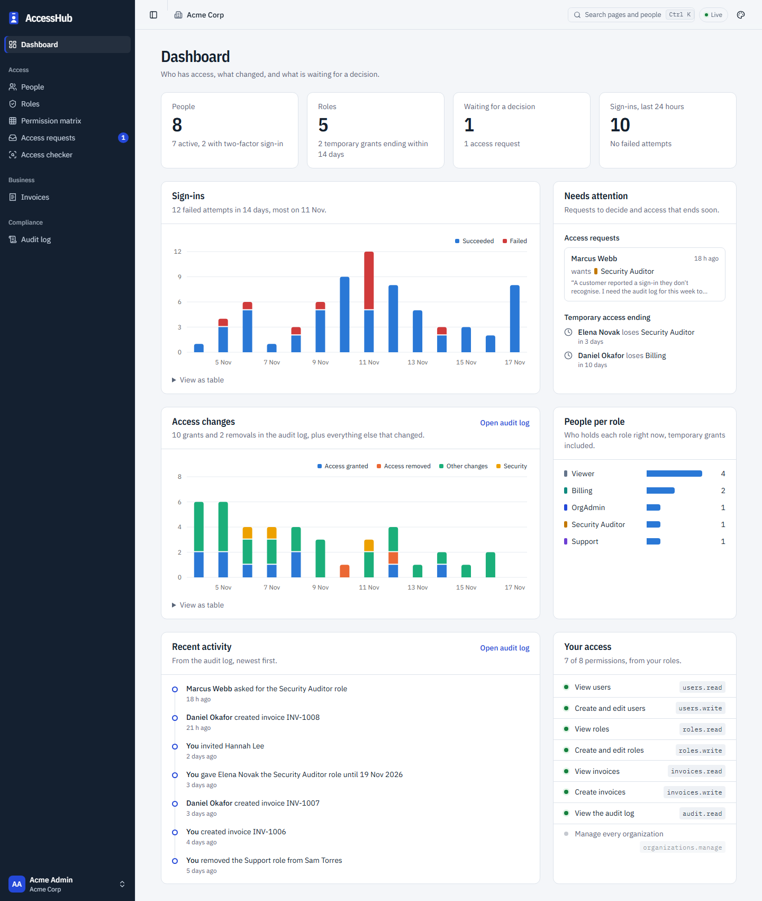

**People and temporary roles.** Invite people by email. Grant a role permanently or until a date; a background job removes it when the time is up, and the audit log records it. Deactivating someone signs them out everywhere at once, with an Undo.

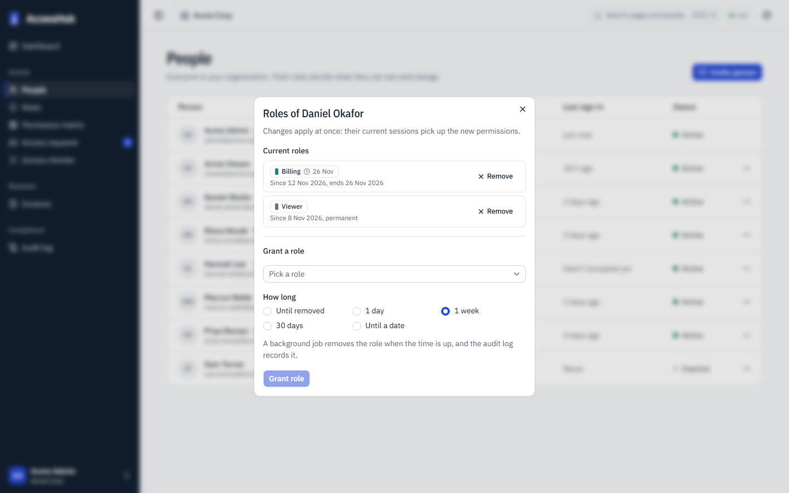

**Permission matrix.** Every role against every permission. Ticking a box saves straight away (optimistic UI with an Undo toast), and boxes for permissions you don't hold are read-only: nobody can hand out access they don't have.

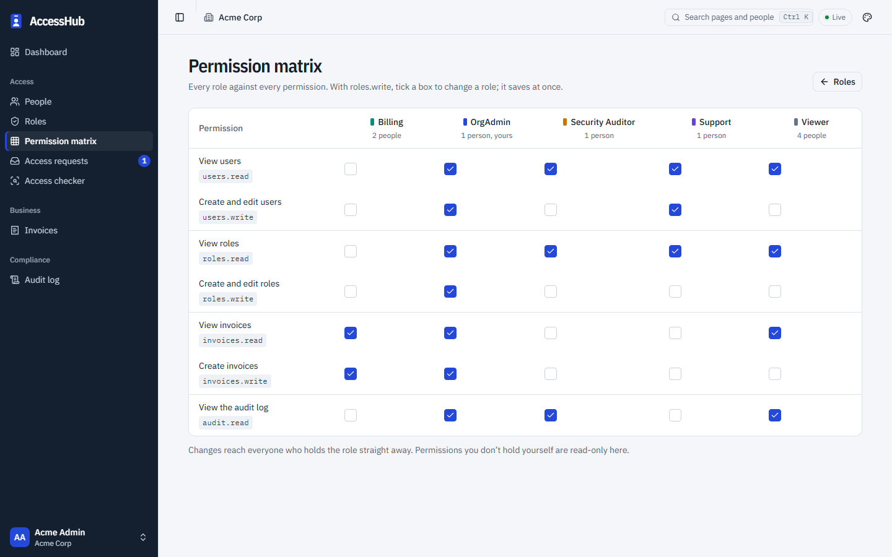

**Access requests.** "You can't view invoices" pages link to a request form with the permission filled in. Approvers get a live notification and can approve for a week; the requester's open session gains the permission within seconds, without signing in again.

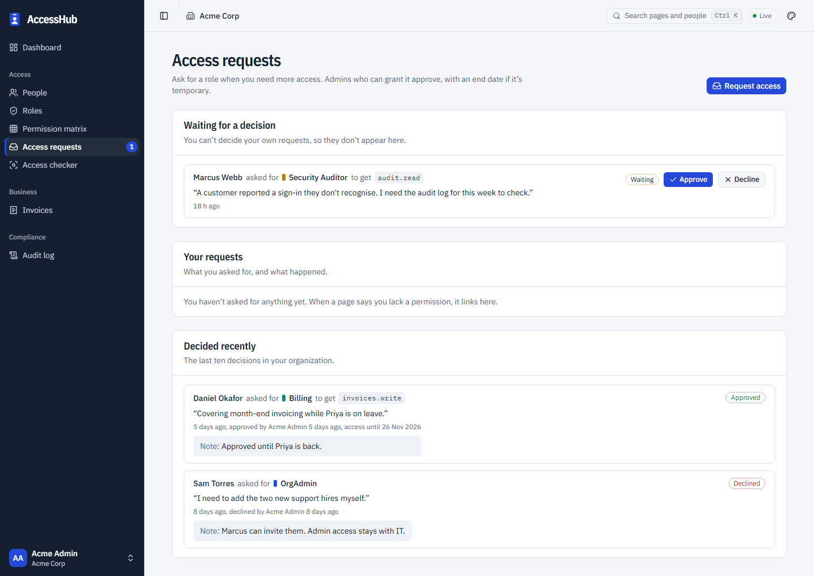

**Access checker.** Pick a person and a permission: the answer, the roles that grant it (or would), and the console as that person sees it.

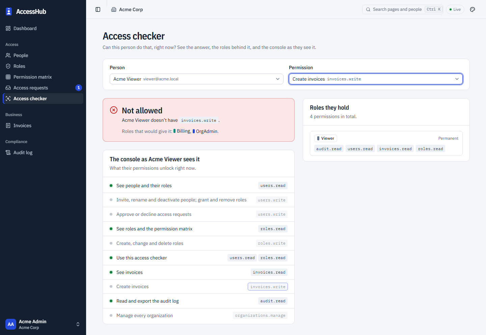

**Audit log.** Every change in plain language, filterable by date, person, item and action, with a field-by-field diff of what it was before. The filtered view exports to CSV.

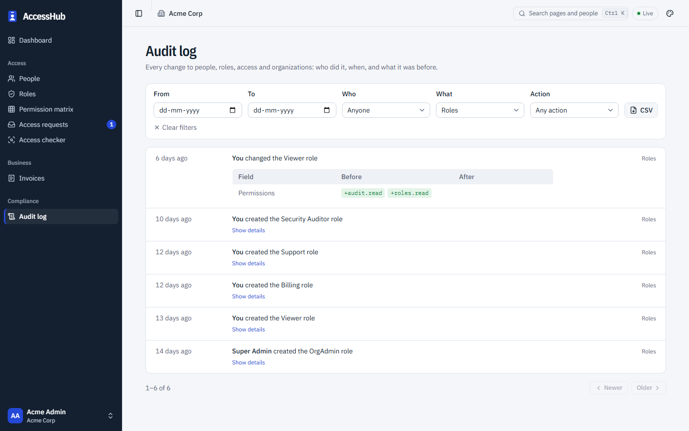

**Account security.** Two-factor sign-in with an authenticator app and recovery codes, every signed-in device with "sign out" and "sign out everywhere", and the access token's countdown.

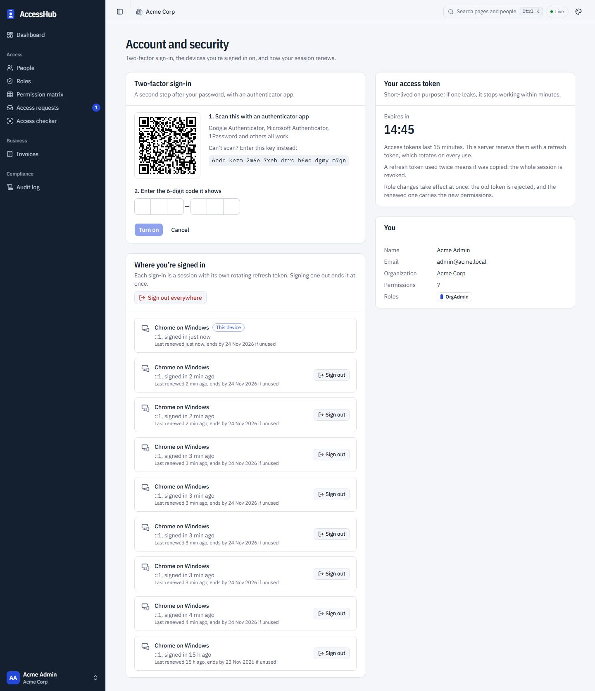

<table>
  <tr>
    <td width="50%">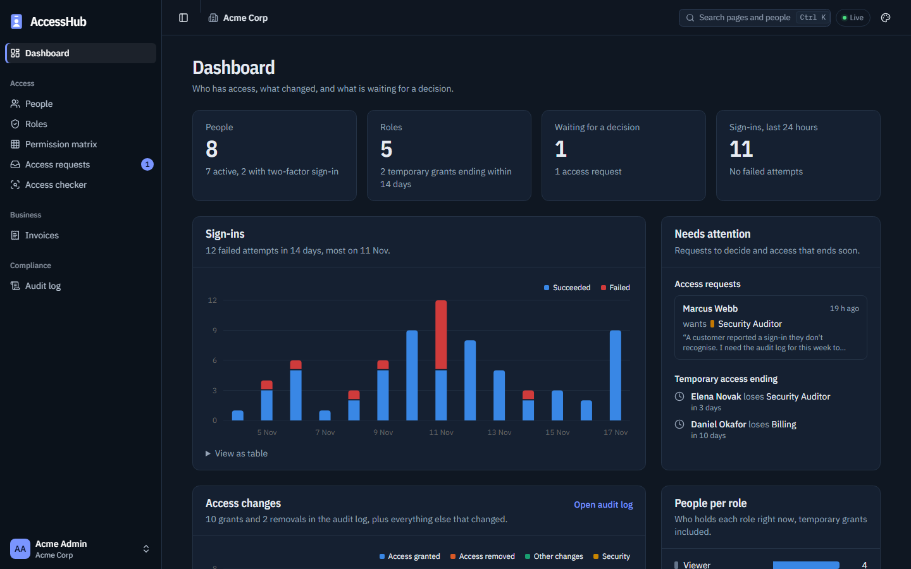<br><sub>Dark mode, with a choice of accent colors (organizations can set their own)</sub></td>
    <td width="50%">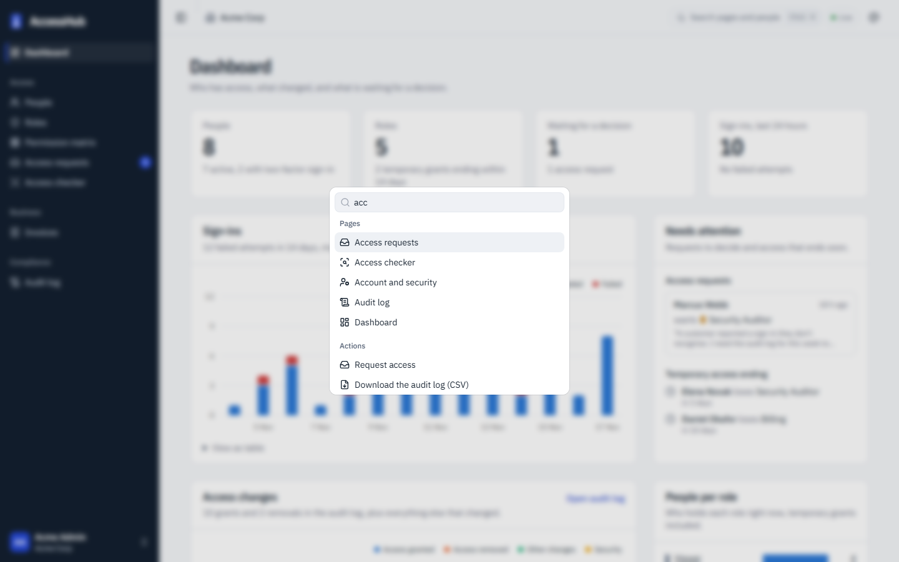<br><sub>Ctrl+K jumps to any page, action or person</sub></td>
  </tr>
  <tr>
    <td>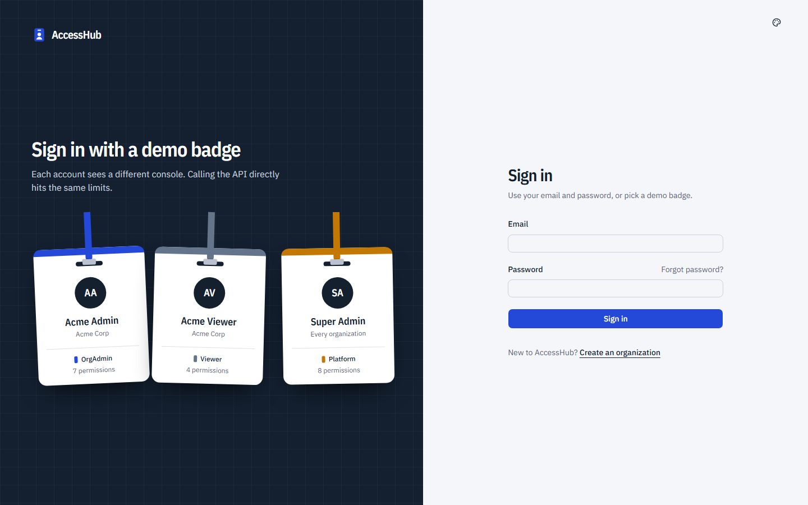<br><sub>Sign in with a demo badge; two-factor, Google and Microsoft are supported</sub></td>
    <td>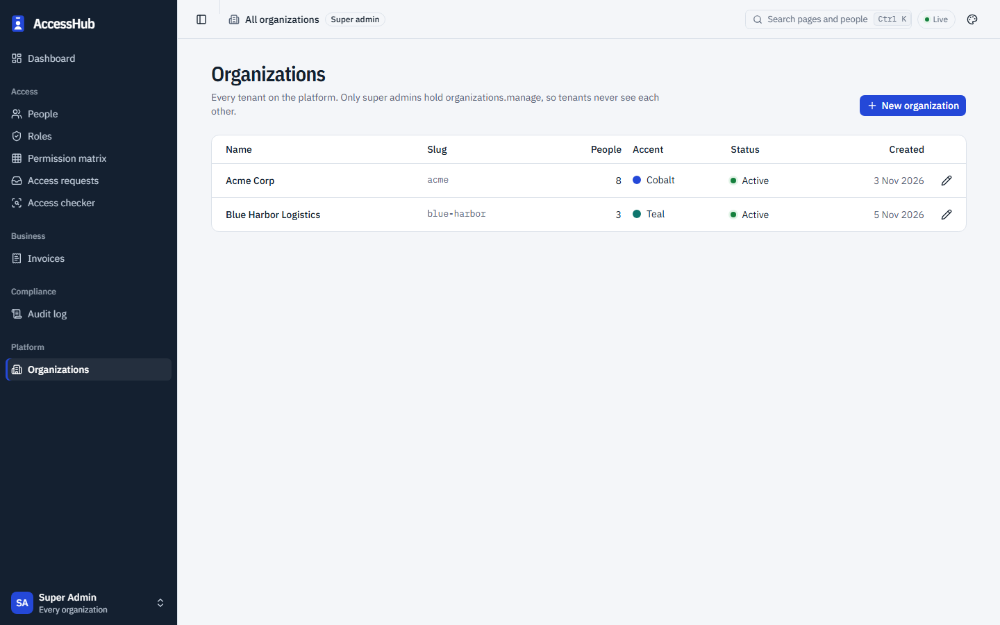<br><sub>The super admin's view of every tenant</sub></td>
  </tr>
</table>

<p>
  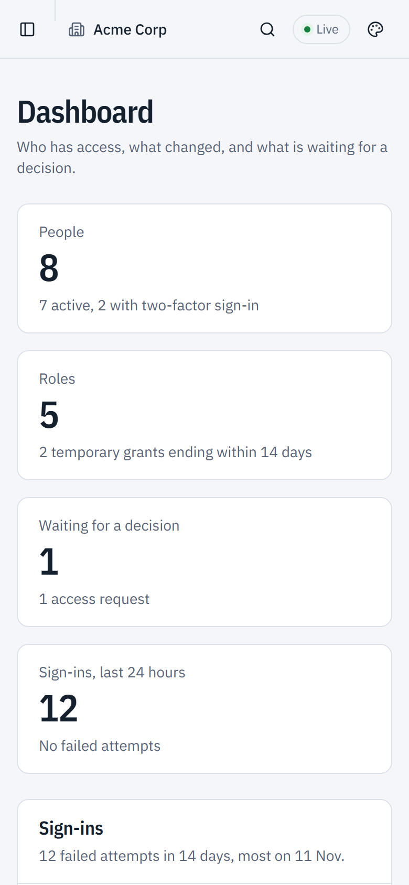
  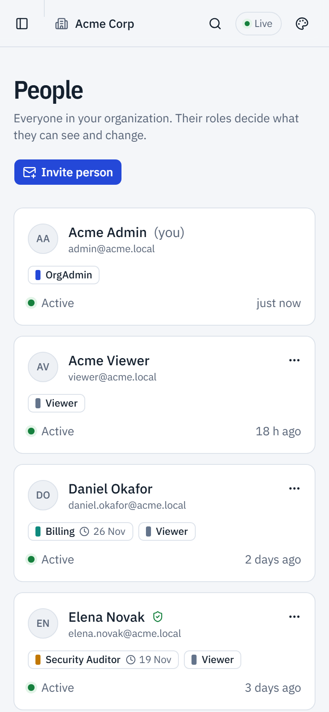
</p>

Every page works from 360px phones up; tables turn into cards on small screens, and an end-to-end test checks that nothing overflows at 360, 768 and 1280 pixels.

## Security features, and where to read them

| Feature | How it works | Code |
|---|---|---|
| Short-lived access tokens, rotating refresh tokens | Access tokens last 15 minutes. Each refresh rotates the refresh token; presenting an already-used one (outside a 30-second grace for parallel requests) means it was copied, so the whole session is revoked. Sessions end after 7 idle days or 30 days in total. | [SessionService.cs](src/AccessHub.Infrastructure/Services/SessionService.cs) |
| Instant revocation | Tokens carry a fingerprint of the user's security stamp. Changing roles, resetting a password or "sign out everywhere" rotates the stamp, and the API rejects old tokens on the next request (checked through a 30-second cache). | [AccessTokenValidator.cs](src/AccessHub.Infrastructure/Services/AccessTokenValidator.cs), [Program.cs](src/AccessHub.Api/Program.cs) |
| Lockout and rate limiting | Five wrong passwords or codes lock the account for 15 minutes (HTTP 423). Sign-in, refresh and recovery endpoints are rate-limited per client address, and the Next.js server forwards the browser's address. | [AuthController.cs](src/AccessHub.Api/Controllers/AuthController.cs), [Program.cs](src/AccessHub.Api/Program.cs) |
| Two-factor sign-in | TOTP with an authenticator app (QR code) and single-use recovery codes. The password step returns a 5-minute challenge token, not a session. | [AccountController.cs](src/AccessHub.Api/Controllers/AccountController.cs) |
| Invitations and password reset | Single-use links by email (MailKit), sent from a Hangfire queue with retries. Invitations last 3 days, reset links 2 hours, and a reset signs out every device. | [UsersController.cs](src/AccessHub.Api/Controllers/UsersController.cs), [Email](src/AccessHub.Infrastructure/Email) |
| Access requests | Separation of duties: nobody decides their own request. Approval can be temporary, and every step is audited. | [AccessRequestsController.cs](src/AccessHub.Api/Controllers/AccessRequestsController.cs) |
| Temporary roles | Expired grants stop counting at once (permission checks ignore them) and a minutely Hangfire job removes them, audits it and notifies the person. | [ExpiredRoleAssignmentsJob.cs](src/AccessHub.Infrastructure/Jobs/ExpiredRoleAssignmentsJob.cs) |
| No privilege escalation | Granting, approving, inviting or editing a role is refused (403) if it would hand out a permission the caller doesn't hold. Editors can't remove their own last source of a permission (409), and organization roles can never include the platform-wide `organizations.manage`. | [CurrentUserService.cs](src/AccessHub.Api/Services/CurrentUserService.cs), [RolesController.cs](src/AccessHub.Api/Controllers/RolesController.cs) |
| Tenant isolation | EF Core 10 named query filters scope every organization-owned table to the caller's tenant, so a query that forgets its `OrganizationId` check still can't leak another tenant's data. Background jobs opt out by name. | [AccessHubDbContext.cs](src/AccessHub.Infrastructure/Persistence/AccessHubDbContext.cs) |
| Backend-for-frontend | The browser never holds a token: Next.js keeps both in httpOnly cookies, renews them in the proxy before rendering, and retries once after a revocation. | [proxy.ts](web/src/proxy.ts), [session.ts](web/src/lib/session.ts), [api.ts](web/src/lib/api.ts) |
| Live updates | SignalR pushes "something changed" messages; pages re-render through Next.js with the user's own permissions. Browsers connect with a 2-minute ticket that only the hub accepts. | [NotificationsHub.cs](src/AccessHub.Api/Realtime/NotificationsHub.cs), [realtime-bridge.tsx](web/src/components/console/realtime-bridge.tsx) |
| Audit trail | Saved in the same transaction as the change it describes, with before/after snapshots. The CSV export defuses spreadsheet formulas. | [AuditController.cs](src/AccessHub.Api/Controllers/AuditController.cs), [AuditService.cs](src/AccessHub.Infrastructure/Services/AuditService.cs) |
| Errors and operations | RFC 9457 problem details for every error, Serilog request logging, `/health` and `/health/ready` probes, Google and Microsoft sign-in when configured. | [Program.cs](src/AccessHub.Api/Program.cs) |

## Architecture

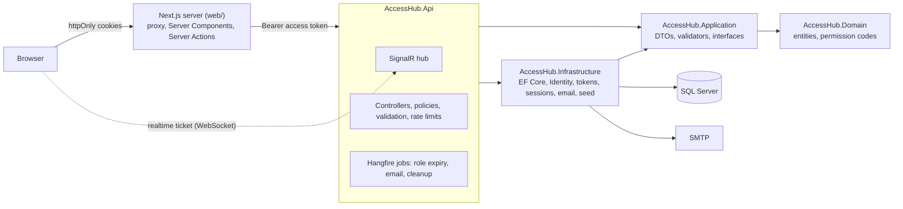

Clean Architecture: dependencies point inward, and the Domain has none. The data model, the sign-in and refresh sequences, and the tenant filters are explained in [docs/ARCHITECTURE.md](docs/ARCHITECTURE.md).

| Area | Technology |
|---|---|
| API | .NET 10 (LTS), ASP.NET Core controllers, SignalR, OpenAPI 3.1 with Scalar |
| Identity | ASP.NET Core Identity (password hashing, lockout, TOTP), JWT bearer, policy-based authorization |
| Data | EF Core 10, SQL Server, code-first migrations, named query filters |
| Background work | Hangfire on SQL Server |
| Email | MailKit (smtp4dev locally) |
| Validation and errors | FluentValidation 12, RFC 9457 problem details |
| Logging and health | Serilog, ASP.NET Core health checks |
| Web | Next.js 16 (App Router, Server Components, Server Actions, Partial Prerendering), React 19, TypeScript |
| UI | shadcn/ui on Radix, Tailwind CSS 4, Recharts, next-themes, IBM Plex |
| Tests | xUnit, FluentAssertions, WebApplicationFactory, Testcontainers, Playwright |
| Delivery | Docker, Docker Compose, GitHub Actions |

## Run it for development

**Prerequisites:** [.NET 10 SDK](https://dotnet.microsoft.com/download/dotnet/10.0), [Node.js](https://nodejs.org/) 20.9 or later, and SQL Server (LocalDB, Express, or `docker compose up -d sqlserver`).

```powershell
Copy-Item .env.example .env              # keep the connection string that matches your SQL Server
dotnet run --project src/AccessHub.Api   # applies migrations and seeds the demo data on first run
```

```powershell
cd web
npm ci
npm run dev                              # http://localhost:3000
```

Without an SMTP server, invitation and reset emails (links included) are written to the API's log. The Hangfire dashboard is at http://localhost:5177/hangfire in development.

## Tests and CI

| Suite | What it covers | Run |
|---|---|---|
| Unit (27) | Permission resolution, the permission catalog, validation rules including the escalation guard | `dotnet test tests/AccessHub.Tests` |
| Integration (14) | The real API over HTTP against SQL Server: refresh-token reuse, lockout, tenant isolation, delegation and self-lockout guards, token revocation after a grant, role expiry with a fake clock, realtime tickets, CSV export | `dotnet test tests/AccessHub.IntegrationTests` |
| End-to-end (14) | Playwright against the running stack: the demo accounts, a live access request between two browsers, the matrix with Undo, the access checker, audit filters and CSV, and layouts at 360, 768 and 1280 pixels | `cd e2e; npm ci; npx playwright test` |

Integration tests start SQL Server with Testcontainers. Without Docker, point them at a server instead and they use a throwaway database: `$env:ACCESSHUB_TEST_SQL = 'Server=.\SQLEXPRESS;Trusted_Connection=True;TrustServerCertificate=True'`.

[CI](.github/workflows/ci.yml) builds with warnings as errors, runs all three suites (end-to-end against `docker compose`), lints and type-checks the web app, and fails on known-vulnerable packages.

## Design decisions

**Short tokens, rotating refresh tokens, and a stamp check.** Permissions travel in the access token, so most requests need no database lookup. Three things keep that safe. Tokens last 15 minutes. A fingerprint of the security stamp lets the API reject a token the moment roles change (one cached query per user per 30 seconds). Refresh tokens rotate with reuse detection, so a stolen one is useful only until its owner refreshes.

**Next.js as a backend-for-frontend.** Only the Next.js server talks to the API, server-to-server, so no token ever reaches JavaScript. Server Components can't set cookies, so the proxy renews a token before a page renders, and a page whose token was revoked mid-session bounces through `/auth/refresh` and straight back. The one browser-to-API connection is the SignalR hub, which accepts only short-lived tickets with their own audience.

**Defense in depth for tenants.** Controllers scope queries by organization, and EF Core's named query filters do it again underneath. The filters fail closed: an anonymous request or a background job sees nothing unless it opts out by name.

**Delegation, not just permission.** Having `users.write` doesn't mean you can grant `OrgAdmin`. Every path that hands out access checks that the caller holds every permission involved. That closes the classic RBAC escalation where a helpdesk role promotes a friend to admin.

**Static shell, streamed data.** With Cache Components, auth pages are static and every console page prerenders its frame. Anything that depends on the signed-in user streams in behind `<Suspense>` with a skeleton. Tables are Server Components; only dialogs, menus and charts ship JavaScript.

**Charts that read the same for everyone.** Series colors come from a palette validated for color-vision deficiency in light and dark mode, not from the switchable accent. Each chart has a table view.

**Shared demo accounts.** With `Demo:Enabled`, the demo accounts can't turn on two-factor, change their password or be deactivated, so one visitor can't lock out the next, and a nightly job restores the demo data.

**Configuration.** No secrets in `appsettings.json`: local development reads a git-ignored `.env`, other environments use environment variables or a secret store. NuGet versions are pinned centrally in `Directory.Packages.props`.

## Deploying

[docs/DEPLOYMENT.md](docs/DEPLOYMENT.md) covers Azure App Service and Azure SQL for the API, Vercel or Azure Static Web Apps for the web app, and the settings a public demo needs.

## Known limitations

- **One API instance:** the token-state cache and the external sign-in codes live in memory, and SignalR has no backplane. Several instances need a distributed cache (Redis) and Azure SignalR Service or a Redis backplane.
- **Several web instances** need a shared `NEXT_SERVER_ACTIONS_ENCRYPTION_KEY`.
- **Next steps:** passkeys (WebAuthn), SCIM provisioning, and attribute-based conditions on top of roles.

## Project structure

```
src/
  AccessHub.Domain/          Entities, permission codes, field lengths (no dependencies)
  AccessHub.Application/     DTOs, validators, interfaces, permission service
  AccessHub.Infrastructure/  EF Core, migrations, Identity, tokens, sessions, email, jobs, seed data
  AccessHub.Api/             Controllers, authorization, SignalR hub, rate limits, OpenAPI, Dockerfile
tests/
  AccessHub.Tests/              Unit tests
  AccessHub.IntegrationTests/   API tests against SQL Server (WebApplicationFactory, Testcontainers)
web/                         Next.js: the backend-for-frontend and the console UI (Dockerfile)
e2e/                         Playwright end-to-end tests
scripts/                     Screenshot and demo GIF recorders
docs/                        Architecture, deployment, recording
```

## License

MIT
