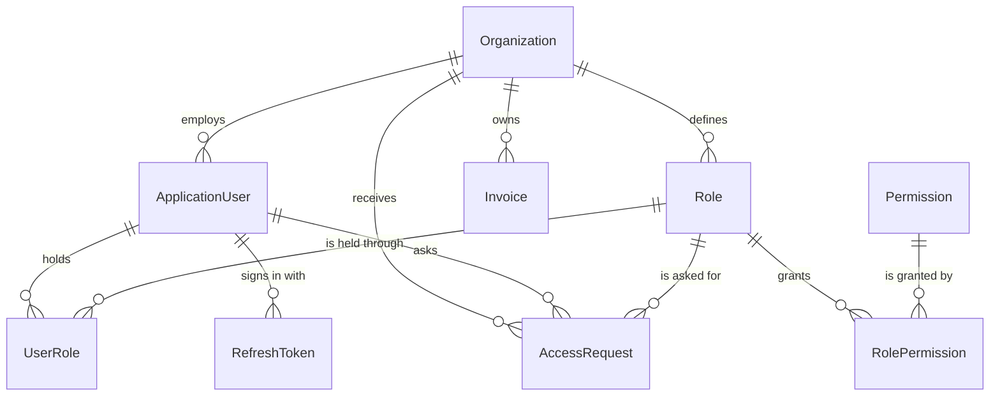
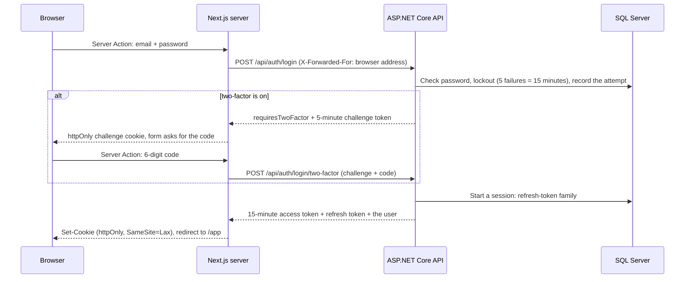
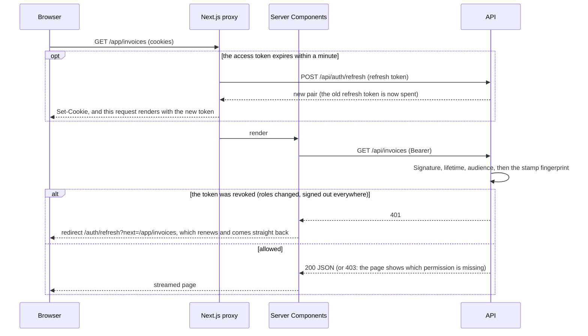
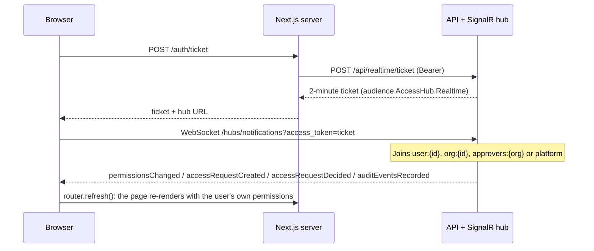

# AccessHub architecture

## Data model



- **Permission:** the global catalog of `resource.action` codes (`invoices.read`, `users.write`...). `organizations.manage` is platform-wide and only super admins hold it.
- **Role:** belongs to one organization and grants a set of permissions.
- **UserRole:** a person holds a role, permanently or until `ExpiresAtUtc` (temporary access), with who granted it.
- **AccessRequest:** someone asks for a role (optionally naming the permission they needed); an approver decides, possibly for a limited time.
- **RefreshToken:** one row per issued refresh token, stored as a SHA-256 hash. Tokens of one sign-in share a `FamilyId`: that family is a *session*.
- **SignInAttempt:** every sign-in, successful or not, for the security charts. No foreign keys, so attempts for unknown emails are kept too.
- **AuditEvent:** who did what to which item, with a JSON payload (before/after snapshots for updates).
- **Super admin:** `IsSuperAdmin = true` and no organization; holds every permission.

## Requests

The browser talks to the Next.js server only. The Next.js server calls the API server-to-server with the user's access token, which it keeps in an httpOnly cookie next to the refresh token.

### Sign-in, with two-factor



### Rendering a page, and renewing the session



**Refresh-token rotation.** Every refresh spends the presented token and issues a new one in the same family. A spent token presented again (more than 30 seconds later, which allows for parallel requests) means it was copied, so every token of that family is revoked and the session ends. A family also ends after 7 days without use or 30 days in total.

**Instant revocation.** Access tokens carry `sst`, a fingerprint of the user's security stamp. Granting or removing roles, approving a request, resetting a password, changing two-factor sign-in and "sign out everywhere" rotate the stamp, and `OnTokenValidated` rejects tokens with the old fingerprint (cached per user for 30 seconds, and evicted at once on the instance that made the change). The session survives a role change: the next refresh issues a token with the new permissions.

### Live updates



Messages carry no data a page would show; they only say what changed. The ticket's audience is accepted by the hub alone, and the API's main scheme rejects it, so a leaked ticket can't call the API.

## Tenant isolation

Every organization-owned entity (roles, role grants, role permissions, invoices, audit events, access requests, sign-in attempts) has an EF Core 10 named query filter:

```csharp
builder.Entity<Invoice>().HasQueryFilter(TenantFilter, i => SeesAllTenants || i.OrganizationId == CurrentOrganizationId);
```

`CurrentOrganizationId` comes from the access token, through `ICurrentTenant`. Super admins see every tenant. Requests without a tenant (anonymous, or a background job) match nothing until they opt out by name, `IgnoreQueryFilters(["Tenant"])`, which the role-expiry job, permission resolution at sign-in and the seeder do on purpose. Users are not filtered, because sign-in must find them before any tenant is known; every user query is scoped explicitly.

## Granting access

| Rule | Where |
|---|---|
| Only roles in the caller's organization can be granted | `UsersController`, `AccessRequestsController` |
| Nobody grants, approves, invites with or edits a role that includes a permission they don't hold (403) | `CurrentUserService.MissingPermissions` |
| Nobody removes their own last source of a permission (409) | `RolesController.SelfLockoutAsync` |
| Nobody changes their own roles or deactivates themselves | `UsersController` |
| Nobody decides their own access request | `AccessRequestsController` |
| Organization roles can't include `organizations.manage` | `RuleExtensions.GrantableByOrganizationRole` |

## Background jobs (Hangfire)

| Job | Schedule | What it does |
|---|---|---|
| `expire-temporary-roles` | Every minute | Removes expired role grants, audits each (actor: System), revokes the person's tokens and notifies them |
| `clean-up-sessions` | Daily, 03:00 UTC | Deletes refresh tokens that expired or were revoked over a week ago |
| `reset-demo` | Daily, 04:00 UTC, only with `Demo:Enabled` | Deletes all tenant data and seeds the demo again |
| Email | On demand | Sends invitations and password resets with retries |

Permission checks already ignore expired grants, so the expiry job is about tidying up, notifying and auditing, not security.

## Layers

| Layer | Responsibility |
|-------|----------------|
| **Domain** | Entities, permission codes and which ones organization roles may grant, field lengths |
| **Application** | DTOs, FluentValidation validators, interfaces (sessions, tokens, tenant, notifier, email), permission service |
| **Infrastructure** | EF Core context, configurations and migrations; Identity; tokens and sessions; email; Hangfire jobs; seed data |
| **Api** | Controllers, authorization policies, rate limiting, problem details, SignalR hub, health checks, OpenAPI |
| **Web** (Next.js) | Session cookies, server-side API calls, Server Actions, the realtime connection, the console UI |

## Security notes

- Passwords are hashed by ASP.NET Core Identity. Identity is registered with `AddIdentityCore`, so JWT bearer stays the default scheme: `AddIdentity` would make cookies the default and redirect API calls to a login page.
- JWTs are signed with HS256. `Jwt__Key` comes from `.env` locally and from an environment variable or secret store elsewhere; startup fails if it is shorter than 32 characters.
- Refresh tokens and their reset/invitation counterparts are random and single-use; refresh tokens are stored hashed.
- Validation runs before controllers; failures are 400 problem details with field errors. Unhandled exceptions become 500 problem details without internals; duplicate keys become 409.
- Rate limits partition by client address. The API trusts `X-Forwarded-For` only from loopback and the networks listed in `ForwardedHeaders:TrustedNetworks`.
- CORS allows the web origin, on the SignalR hub only.
- The web app sends `X-Frame-Options: DENY`, `X-Content-Type-Options: nosniff` and a strict referrer policy. Server Actions check the request's Origin.
- No secrets in `appsettings.json`; `.env` files are git-ignored.
